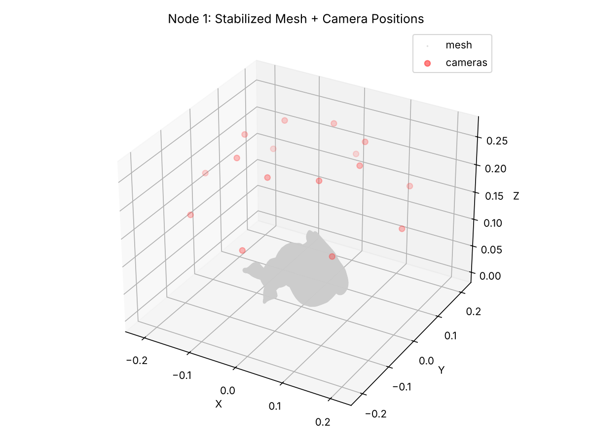
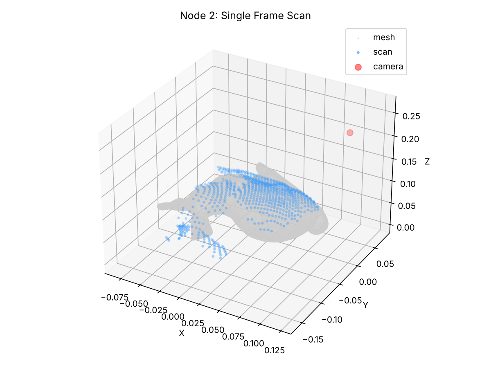
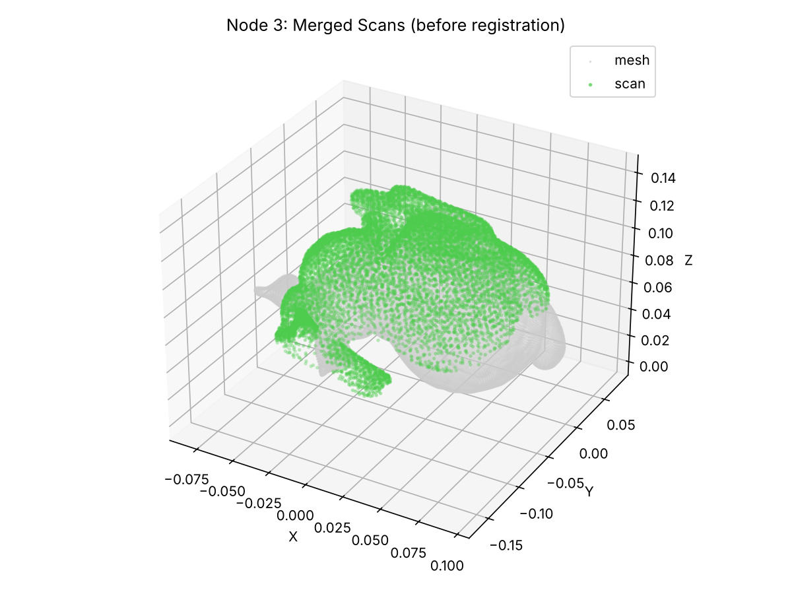
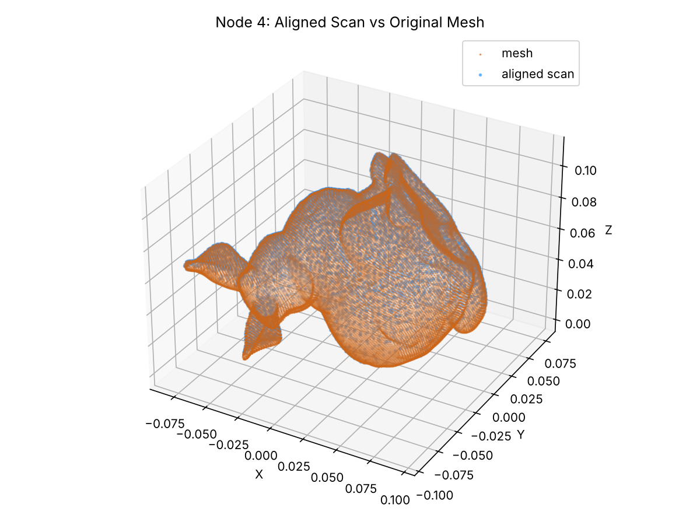

# Pcd-sim

A small Python simulator for **robot-arm style 3D scanning**. Give it a mesh, and it will place a virtual depth camera around the object, scan it from many viewpoints, merge the point clouds, and register the result back against the model with FPFH + Fast Global Registration + ICP.

I built it to practice the full scan → merge → register pipeline without needing a physical scanner or a robot. Everything is generated from a mesh, so the ground truth is always known.

| Camera poses | Single scan | Merged scans | Registered result |
|:---:|:---:|:---:|:---:|
|  |  |  |  |

## Pipeline

```
mesh ──► PoseGenerator ──► Scanner ──► Registration ──► Visualizer
         stable pose        ray casting   merge, FPFH,     4 result
         + camera poses     per pose      FGR, ICP         images
```

1. **`poses.py` – PoseGenerator.** Finds the most stable resting pose of the mesh (`trimesh.poses.compute_stable_poses`), puts it on the XY plane with its centre at the origin, fits a bounding cylinder, and places cameras on a spherical grid around it (`--thetas` azimuth steps × `--phis` zenith levels). Every camera looks at the object's centre.
2. **`scanner.py` – Scanner.** Simulates a depth camera (64×48 rays, 62°×48° FOV, depth range scaled to the object). Rays are cast against the mesh with `trimesh`, and hits are filtered by depth and field of view.
3. **`registration.py` – Registration.** Merges all frames, downsamples, estimates normals, computes FPFH features, does a coarse alignment with Fast Global Registration, then refines with point-to-plane ICP (Open3D).
4. **`visualizer.py` – Visualizer.** Saves a PNG for each stage (matplotlib) and can open interactive Open3D windows.
5. **`logger.py`.** Console + timestamped log file per run, in `logs/`.

## Quick start

```bash
git clone https://github.com/Xing0722/Pcd-sim.git
cd Pcd-sim

conda env create -f environment.yml
conda activate pcd-sim

# optional, but ray casting goes from ~4 s to ~0.01 s per view
pip install embreex

# the Stanford bunny is already in data/
python main.py --mesh data/bunny.obj --no-show --perturb
```

Options:

| Flag | Default | What it does |
|---|---|---|
| `--mesh` | `data/bunny.obj` | Input mesh (anything `trimesh` can load) |
| `--thetas` | `8` | Number of camera positions around the object |
| `--phis` | `2` | Number of zenith-angle levels (30° to 60°) |
| `--out-dir` | `results` | Where the PNGs and `metrics.json` go |
| `--no-show` | off | Skip interactive Open3D windows, save PNGs only |
| `--perturb` | off | Move the scans by a known random rigid transform before registering, then report how well it is recovered |
| `--perturb-deg` | `30` | Rotation used by `--perturb` |
| `--perturb-trans` | `0.2` | Translation used by `--perturb`, as a fraction of the object's bounding-box diagonal |
| `--seed` | `0` | Seed for `--perturb` |

Depth range and voxel size are derived from the object's size, so meshes in metres or millimetres both work (the bundled `bunny.obj` is in metres, `armadillo.obj` is not).

## Results

The scans are generated in the model's own frame, so without `--perturb` the registration only has to return the identity. With `--perturb` the scans are first knocked out of alignment by a known transform, and the pipeline has to find its way back. The images above come from this mode (30° rotation, translation of 20% of the bounding-box diagonal).

Stanford bunny, 16 camera poses, 11,854 merged points:

- FGR fitness 0.88, then ICP fitness 1.00
- Rotation error 0.011°, translation error 0.007% of the bounding-box diagonal
- RMS distance of the registered scan to the nearest mesh vertex: 0.57 mm (this is the vertex-spacing floor of the mesh, not a sensor error)

Robustness, with 10 random perturbations per angle (random axis, random translation of 20% of the diagonal). A run counts as a success if rotation error is below 1° and translation error is below 1% of the diagonal:

| Initial rotation | 15° | 30° | 60° | 90° | 120° | 150° | 180° |
|---|---|---|---|---|---|---|---|
| Successful runs | 10/10 | 10/10 | 10/10 | 10/10 | 9/10 | 7/10 | 9/10 |

So FPFH + FGR handles most initial poses, and starts to fail occasionally beyond about 120°. The failures are the interesting part to look at next.

## Things to know

- **The scan is noise-free.** Points come straight from ray hits on the mesh, so the result is cleaner than a real sensor would give.
- **The merge step assumes known camera poses.** Each frame is already in world coordinates, so registration here is "scan vs. model", not frame-to-frame stitching.
- **Only the upper side of the object is seen.** The object rests on its most stable pose and cameras sit between 30° and 60° from vertical, so the underside is never scanned.
- **Without `embreex`** ray casting uses trimesh's pure-Python tracer, which is slow and memory hungry (about 2 GB after a few views on the bunny).

## Ideas for next steps

- Sensor model: depth noise, dropouts, incidence-angle cutoff
- Camera pose error (a robot-arm calibration offset), and how well registration recovers from it
- Look into the 150° failures: more FPFH radius options, or RANSAC instead of FGR as the coarse step
- Pick the best-fit bounding shape (cylinder / box / sphere) with `trimesh.primitives` instead of always using a cylinder
- Coverage metric: what fraction of the surface was actually seen, and a next-best-view selection

## Project layout

```
main.py            entry point / CLI / evaluation
poses.py           stable pose, bounding cylinder, camera poses
scanner.py         virtual depth camera (ray casting)
registration.py    merge, FPFH, FGR, ICP
visualizer.py      PNG + Open3D visualisation
logger.py          logging
data/              sample meshes (+ download.py to fetch them)
results/           example output (PNGs + metrics.json)
environment.yml    conda environment
```

## Dependencies

Python 3.10, NumPy, SciPy, Matplotlib, trimesh, Open3D, NetworkX, rtree. Optional: embreex.

## Sample data

Meshes come from [common-3d-test-models](https://github.com/alecjacobson/common-3d-test-models). `data/download.py` fetches them.
